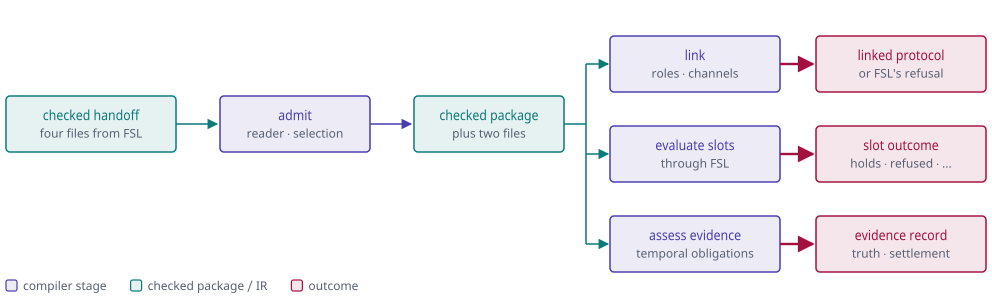
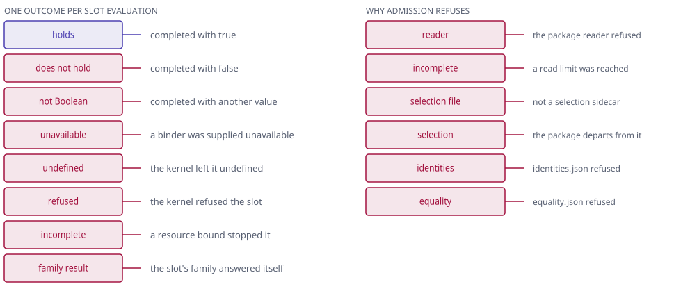

# filament-protocol

[](https://discord.gg/k8DVhuYBR2)
[](https://github.com/agent-ix/filament-spec-language)

filament-protocol is a Rust crate that consumes the checked package the Filament
Specification Language (FSL) produces for a protocol. A protocol describes
roles that exchange messages over channels, together with the steps that undo
earlier work when something fails.

The crate admits a checked-package handoff, links one protocol clause into its
roles, channels, queues and controls, evaluates protocol slots and temporal
evidence through FSL's evaluation entries, and keeps the compensation state
machine. Every refusal carries the value of the component that produced it, and
resource bounds are declared up front.

<picture>
  <source media="(prefers-color-scheme: dark)" srcset="docs/images/hero-dark.svg">
  
</picture>

## Getting started

filament-protocol is not published to a registry. Add it as a git dependency:

```toml
[dependencies]
filament-protocol = { git = "https://github.com/agent-ix/filament-protocol", branch = "main" }
```

To build from a clone, install the Rust toolchain named in `rust-toolchain.toml`
and run `cargo build`.

## Usage

`admit` reads the four files of a checked-package handoff directory:
`checked-package.json`, `selection.json`, `identities.json` and `equality.json`.
It reads the package with Contract IR's reader, compares it with the selection,
and reads the identity and equality files against it. `link` then builds the
linked protocol for one protocol clause of the admitted package.

```rust
let admitted = admit(
    &HandoffFiles {
        checked_package: &files["checked-package.json"],
        selection: &files["selection.json"],
        identities: &files["identities.json"],
        equality: &files["equality.json"],
    },
    &evidence,
    CheckedPackageReadLimits::bounded(),
    &mut join_budget(),
)?;
let linked = link(admitted.package(), &clause)?;
```

`evidence` is the evidence assembled from the handoff's files, `join_budget()`
is the caller's native-join allowance for the pass, and `clause` is the node id
of a protocol clause in the package.

## Outcomes

A slot evaluation returns a `SlotOutcome` that carries FSL's value unchanged.
Admission returns a `Refusal` with one variant per file or check that failed.
In addition to the package and sidecar results shown below,
`Refusal::CatalogUnavailable` carries Contract IR's `CatalogReadError` unchanged
when the reader cannot read its operation catalog. That result concerns the
reader's catalog, not the offered package, and stops admission before sidecar
checks.

<picture>
  <source media="(prefers-color-scheme: dark)" srcset="docs/images/outcomes-dark.svg">
  
</picture>

## Reference

| Module | What it holds |
| --- | --- |
| `checked_package` | Admission of the checked-package handoff. |
| `link` | The linked protocol over FSL's read view and causal relation. |
| `slot` | The outcome of evaluating a protocol slot. |
| `evidence` | Temporal evidence read from the checked package's own nodes. |
| `compensation` | Activation, registration, ordering and retry facts. |
| `closure`, `outcome` | The closure axes and the closed operation and claim outcomes. |
| `bounds` | Count, allocation and deadline guards. |
| `digest` | The exact-byte SHA-256 carrier. |
| `refusal` | The typed refusal envelope and its catalog. |
| `repro`, `delivery_index` | The reproduction record and the evidence index for one pinned delivery. |

The crate declares no Cargo feature.

## Filament ecosystem

filament-protocol sits beside the compiler. It reads FSL's checked output and
works over observations.

<picture>
  <source media="(prefers-color-scheme: dark)" srcset="docs/images/ecosystem-dark.svg">
  
</picture>

It depends on [filament-spec-language](https://github.com/agent-ix/filament-spec-language),
[filament-eval](https://github.com/agent-ix/filament-eval),
[filament-observation](https://github.com/agent-ix/filament-observation),
[filament-verification-contracts](https://github.com/agent-ix/filament-verification-contracts)
and [engineering-assurance](https://github.com/agent-ix/engineering-assurance).
[filament-contract-ir](https://github.com/agent-ix/filament-contract-ir) supplies the
checked-package reader. The requirements are in [`spec/spec.md`](spec/spec.md).

## Building and testing

```
cargo fmt --all -- --check
cargo clippy --locked --all-targets -- -D warnings
cargo test --locked
RUSTDOCFLAGS="-D warnings" cargo doc --locked --no-deps
```

## Contributing

Read [`CONTRIBUTING.md`](CONTRIBUTING.md) first. Every contribution needs a
signed [CLA](CLA.md). The artifact and rights policy is in
[`ARTIFACTS.md`](ARTIFACTS.md).

## License

AGPL-3.0-or-later. See [`LICENSE`](LICENSE).
